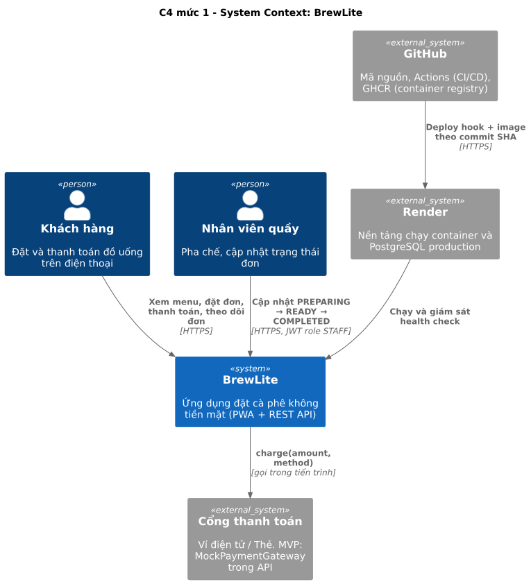
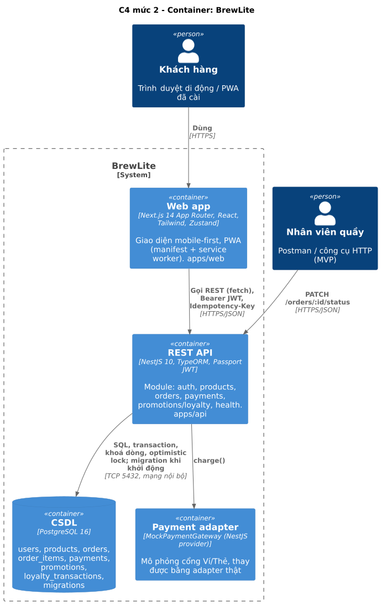

# Task 3.1 – Kiến trúc BrewLite

Kiến trúc được mô tả theo **mô hình C4** (mức 1 Context, mức 2 Container) kết hợp **kiến trúc phân lớp** bên trong backend. Các quyết định quan trọng ghi thành ADR trong [adr/](adr/).

## 1. Ngữ cảnh hệ thống (C4 mức 1)



## 2. Container (C4 mức 2)



| Container | Công nghệ | Thư mục mã nguồn | Triển khai production | Trách nhiệm |
|---|---|---|---|---|
| Web app | Next.js 14 (App Router), React 18, TypeScript, Tailwind, Zustand | `apps/web` | Render Web Service `brewlite-web` (image `ghcr.io/<user>/brewlite-web:<sha>`) | Giao diện mobile-first, PWA, giỏ hàng phía client, gọi REST API |
| REST API | NestJS 10, TypeORM 0.3, Passport JWT, class-validator | `apps/api` | Render Web Service `brewlite-api` (image `ghcr.io/<user>/brewlite-api:<sha>`) | Nghiệp vụ, xác thực, phân quyền, transaction, migration, health check |
| CSDL | PostgreSQL 16 | `apps/api/src/database` (migration) | Render PostgreSQL `brewlite-db`, chỉ truy cập qua Internal URL | Lưu dữ liệu, ràng buộc toàn vẹn (UNIQUE, CHECK, FK) |
| Payment adapter | `MockPaymentGateway` (provider NestJS) | `apps/api/src/payments/mock-gateway.ts` | Chạy trong tiến trình API | Mô phỏng cổng Ví/Thẻ qua interface `charge()`, thay bằng adapter thật không phải sửa nghiệp vụ |

## 3. Frontend Next.js / PWA

- **App Router**, mỗi màn hình một route: `/` Menu, `/products/[id]`, `/cart`, `/login`, `/register`, `/checkout`, `/orders`, `/orders/[id]`, cùng `/health` (route handler) và `/manifest.webmanifest`.
- **Mobile-first**: Tailwind, lưới 2 cột ở 360px; mọi màn hình có trạng thái loading / empty / error (`components/ui.tsx`).
- **State**: Zustand + `persist` (localStorage) cho giỏ hàng và phiên đăng nhập; dữ liệu server luôn lấy mới (`cache: 'no-store'`).
- **PWA**: `app/manifest.ts`, icon 192/512/maskable, `public/sw.js` (network-first cho trang, cache-first cho tài nguyên tĩnh, không cache API), trang `offline.html`, đăng ký service worker chỉ ở production (`components/PwaRegister.tsx`).
- **Gọi API**: `lib/api.ts` gắn `Authorization: Bearer`, `Idempotency-Key`; 401 thì tự đăng xuất. `NEXT_PUBLIC_API_URL` được nhúng lúc build image.
- **Phục vụ nội dung**: Next.js chạy chế độ `output: 'standalone'` trong container; tài nguyên `/_next/static/*` có tên băm nội dung và header cache dài hạn, được trình duyệt và service worker giữ lại. Render Edge kết thúc TLS và chuyển tiếp vào container.

## 4. Backend NestJS theo module / domain (phân lớp)

```
apps/api/src
├── main.ts, app.module.ts, app.setup.ts   # khởi động, ValidationPipe, CORS, logger, shutdown hooks
├── common/        # config (validate env), request-logger, catalog (giá size/topping), current-user, db-errors
├── database/      # data-source.ts (TypeORM + CLI), migrations/
├── entities/      # User, Product, Order, OrderItem, Payment, Promotion, LoyaltyTransaction
├── auth/          # register/login/me, JwtStrategy, JwtAuthGuard, RolesGuard
├── users/         # UsersService
├── products/      # GET /products, GET /products/:id
├── orders/        # tạo đơn, state machine, hủy, cập nhật trạng thái, StockService (optimistic lock)
├── payments/      # thanh toán idempotent, MockPaymentGateway
├── promotions/    # mã giảm giá, cộng/thu hồi điểm, LoyaltyService
├── loyalty/       # GET /loyalty/me
├── seed/          # dữ liệu mẫu (idempotent, tắt bằng SEED=false)
└── health/        # GET /health (kiểm tra CSDL, số migration, phiên bản)
```

| Lớp | Thành phần | Quy tắc |
|---|---|---|
| Presentation | Controller, DTO + class-validator, Guard | Không chứa nghiệp vụ; validate và phân quyền ở biên |
| Application / Domain | Service (`OrdersService`, `PaymentsService`, `StockService`, `PromotionsService`), hàm thuần (`unitPrice`, `computeDiscount`, `assertTransition`) | Nghiệp vụ và transaction; hàm thuần được unit test |
| Infrastructure | TypeORM entity, migration, `MockPaymentGateway`, PostgreSQL | Truy cập dữ liệu, tích hợp ngoài |

## 5. PostgreSQL và migration

- Schema chỉ thay đổi qua **migration TypeORM** trong `apps/api/src/database/migrations` (không dùng `synchronize`). Hiện có `InitialSchema` và `AddRelationsAndChecks` (khoá ngoại, `CHECK stock >= 0`, `CHECK loyaltyPoints >= 0`).
- API chạy migration **khi khởi động** với `migrationsTransactionMode: 'all'`: mọi migration chưa chạy nằm trong một transaction; lỗi thì rollback, ứng dụng dừng, health check không đạt, Render giữ phiên bản cũ (ADR-004).
- Lệnh: `npm run migration:generate`, `migration:run`, `migration:revert` (dev); `migration:run:prod`, `migration:revert:prod` (trong container).
- Integration test xoá schema rồi chạy lại toàn bộ migration ở mỗi lần chạy, chứng minh migration tái tạo được CSDL từ rỗng.

## 6. Dịch vụ thanh toán mô phỏng

`MockPaymentGateway.charge({amount, method, simulateFailure})` trả `{ok, reference, reason}`. Nghiệp vụ chỉ phụ thuộc interface này, nên thay bằng adapter Momo/VNPay chỉ cần một provider mới (ADR-005). Ô “Mô phỏng thanh toán lỗi” ở màn hình thanh toán dùng để demo nhánh `PAYMENT_FAILED`.

## 7. Logging, health check và cấu hình

| Mối quan tâm | Thiết kế | Vị trí |
|---|---|---|
| Logging | Middleware ghi một dòng mỗi request `{method, path, status, ms}`; `LOG_FORMAT=json` ở production; lỗi 5xx mức error, 4xx mức warn; không ghi header, body, query; bỏ qua `/health` 200 | `common/request-logger.ts`; xem trên Render → Logs |
| Health check | API `GET /health`: `SELECT 1`, đếm migration, trả `{status, db, migrations, version, uptime}`; 503 khi CSDL lỗi. Web `GET /health`: `{status, version}`. Render dùng làm health check path; pipeline CD dùng để xác nhận đúng commit SHA đang chạy | `health/health.controller.ts`, `apps/web/app/health/route.ts` |
| Cấu hình | 12-factor: mọi cấu hình qua biến môi trường; `.env.example` liệt kê đủ biến; production kiểm tra lúc khởi động (`DATABASE_URL`, `JWT_SECRET` ≥ 32 ký tự, `CORS_ORIGIN`), thiếu thì dừng ngay | `common/config.ts`, `.env.example`, `render.yaml` |
| Secret | Chỉ ở Render Environment và GitHub Secrets; gitleaks quét mỗi PR | ADR-006 |

## 8. Lý do chọn kiến trúc, ưu điểm, hạn chế, trade-off

| Quyết định | Lý do | Ưu điểm | Hạn chế / trade-off | ADR |
|---|---|---|---|---|
| Monorepo `apps/web`, `apps/api` | Một người làm, một pipeline, truy vết yêu cầu → code → test trong một repo | Một PR thay đổi được cả API và UI; tài liệu nằm cạnh mã | Pipeline chạy cả hai app mỗi PR (chấp nhận được với quy mô nhỏ) | [001](adr/001-monorepo.md) |
| Modular monolith NestJS thay cho microservices | Nghiệp vụ đặt đơn và thanh toán cần transaction ACID chung | Đơn giản, một CSDL, dễ test, rẻ | Không scale độc lập từng phần; ranh giới module phải giữ kỷ luật | [002](adr/002-modular-monolith.md) |
| PostgreSQL + TypeORM | Bắt buộc theo đề; cần khoá dòng, UNIQUE, CHECK | Toàn vẹn dữ liệu ở mức CSDL | ORM ẩn một phần SQL; truy vấn khoá viết tay | [003](adr/003-postgres-typeorm-migrations.md) |
| Migration chạy khi khởi động trong một transaction | Gói miễn phí Render không có pre-deploy command | Không cần bước thủ công; lỗi thì không chuyển traffic | Migration phải tương thích ngược (expand/contract) để rollback image an toàn | [004](adr/004-migration-on-startup.md) |
| Idempotency-Key + khoá dòng + optimistic lock | Rủi ro R-01, R-02 | Không trừ tiền hai lần, không bán vượt kho | Client phải sinh và giữ key; thêm truy vấn kiểm tra | [005](adr/005-idempotent-payment-and-stock.md) |
| Render + GHCR + GitHub Actions | Miễn phí, HTTPS tự động, chạy Docker image, deploy hook nhận image theo SHA | Image bất biến, rollback = triển khai lại SHA cũ | Gói miễn phí ngủ sau 15 phút, Postgres miễn phí hết hạn sau 30 ngày | [006](adr/006-render-ghcr-cicd.md) |
| JWT lưu localStorage | Đơn giản cho SPA gọi API khác origin | Không cần cookie cross-site | Dễ bị lộ nếu có XSS; hướng cải tiến: cookie HttpOnly + refresh token | [007](adr/007-jwt-auth.md) |

## 9. Truy vết deployment → kiến trúc → mã nguồn

| Phần tử trong Deploy-01 | Container (mục 2) | Mã nguồn / cấu hình |
|---|---|---|
| `brewlite-web` (Render Web Service) | Web app | `apps/web`, `apps/web/Dockerfile`, `render.yaml` |
| `brewlite-api` (Render Web Service) | REST API + Payment adapter | `apps/api`, `apps/api/Dockerfile`, `render.yaml` |
| `brewlite-db` (Render PostgreSQL) | CSDL | `apps/api/src/database`, `render.yaml` (`databases`) |
| GitHub Container Registry | – | `.github/workflows/cd.yml` job `image` |
| GitHub Actions runner | – | `.github/workflows/ci.yml`, `cd.yml` |
| Secret / env | Cấu hình (mục 7) | `.env.example`, `render.yaml` `envVars`, GitHub Secrets |
| Health check, log | Mục 7 | `health.controller.ts`, `app/health/route.ts`, `request-logger.ts`, `scripts/smoke-test.mjs` |
| Local: docker compose | Cả ba container | `docker-compose.yml` |

Sơ đồ triển khai chi tiết: [deployment.md](../deployment.md) và [Deploy-01](../diagrams/deployment-production.svg).
