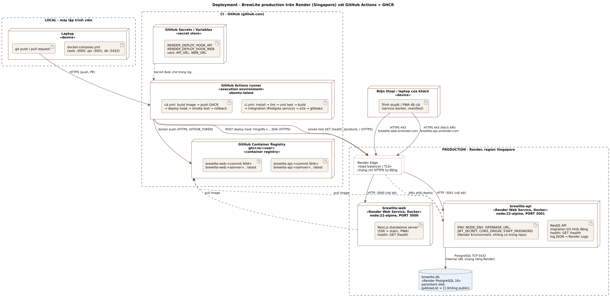

# Triển khai, CI/CD và rollback

Tài liệu này là runbook cho Task 4.4, 5.3 và 5.4. Sơ đồ: [Deploy-01](diagrams/deployment-production.svg) · Quyết định: [ADR-004](architecture/adr/004-migration-on-startup.md), [ADR-006](architecture/adr/006-render-ghcr-cicd.md).

| Môi trường | Web | API | CSDL |
|---|---|---|---|
| Local | http://localhost:3000 | http://localhost:3001 (`/health`) | localhost:5432 (Docker volume `brewlite-db`) |
| CI | runner GitHub, `next start` | runner GitHub, `node dist/main.js` | service container `postgres:16-alpine` |
| Production | `https://brewlite-web.onrender.com` *(điền URL thật)* | `https://brewlite-api.onrender.com` *(điền URL thật)*, `/health` | Render PostgreSQL `brewlite-db`, chỉ Internal URL |



## 1. Pipeline

```
Pull request ──► CI (ci.yml): Install → Lint → Unit Test → Build  (api, web)
                               └► Integration test (PostgreSQL) ─► E2E (Playwright) ; gitleaks
Merge vào main / push tag vX.Y.Z ──► CD (cd.yml):
  quality gate (gọi lại ci.yml) → build image → push ghcr.io/<user>/brewlite-{api,web}:<SHA>
  → deploy hook API (migration chạy khi khởi động) → chờ /health = SHA → deploy hook web
  → smoke test → (lỗi) rollback về SHA trước → dừng pipeline với lỗi
  → (tag) tạo GitHub Release từ docs/releases/<tag>.md
```

| Bước đề yêu cầu (Task 5.3) | Nơi thực hiện |
|---|---|
| 1. Quality gate lint, test, build | Job `quality-gate` gọi `ci.yml` |
| 2. Image tag bằng commit SHA hoặc semver | Job `image`, `docker/metadata-action` (`type=sha,format=long`, `type=semver`) |
| 3. Push image lên registry | GHCR, đăng nhập bằng `GITHUB_TOKEN` |
| 4. Triển khai bằng secret của CI | Deploy hook trong secret `RENDER_DEPLOY_HOOK_API/WEB` (environment `production`) |
| 5. Chạy migration an toàn | Khi container API khởi động, một transaction; lỗi thì bản mới không nhận traffic (ADR-004) |
| 6. Health check / smoke test | `scripts/smoke-test.mjs`: `/health` đúng SHA + CSDL up, `GET /products`, web `/health`, trang Menu, manifest PWA |
| 7. Dừng pipeline và rollback khi thất bại | Bước “Rollback về phiên bản trước” tự chạy khi một bước deploy/smoke lỗi; rollback tay bằng `workflow_dispatch` |

## 2. Thiết lập lần đầu (làm một lần, khoảng 30 phút)

### 2.1 GitHub
1. Tạo repository `brewlite` (public, hoặc private và mời giảng viên với quyền Read). Đẩy mã: `git remote add origin https://github.com/<user>/brewlite.git && git push -u origin main --tags`.
2. **Settings → Actions → General → Workflow permissions**: chọn *Read and write permissions* (để push GHCR và tạo release).
3. **Settings → Environments → New environment** `production` → *Environment secrets*: `RENDER_DEPLOY_HOOK_API`, `RENDER_DEPLOY_HOOK_WEB` (lấy ở bước 2.2.4).
4. **Settings → Secrets and variables → Actions → Variables** (cấp repository, vì job build image web cũng cần): `API_URL` = `https://brewlite-api.onrender.com`, `WEB_URL` = `https://brewlite-web.onrender.com` (không có dấu `/` cuối). `API_URL` được nhúng vào image web lúc build.
5. **Bảo vệ nhánh** – Settings → Branches → Add rule cho `main`: *Require a pull request before merging*; *Require status checks to pass*: chọn `api · install, lint, unit test, build`, `web · install, lint, unit test, build`, `api · integration test (PostgreSQL)`, `e2e · menu → xác nhận đơn (Playwright)`, `quét secret (gitleaks)`; *Require branches to be up to date*. (Các check chỉ hiện trong danh sách sau khi CI chạy ít nhất một lần.)
6. Chạy lần đầu để có image: Actions → CD → *Run workflow* (để trống `rollback_to`). Job `deploy` sẽ thất bại ở bước kiểm tra cấu hình nếu chưa có hook — bình thường. Sau đó vào **Packages** → `brewlite-api` và `brewlite-web` → *Package settings* → *Change visibility* → **Public**.

### 2.2 Render
1. Đăng ký https://render.com bằng tài khoản GitHub.
2. Sửa `render.yaml`: thay `<github-user>` bằng tên tài khoản GitHub viết thường; commit qua PR.
3. **New → Blueprint** → chọn repo → Render tạo `brewlite-db`, `brewlite-api`, `brewlite-web`. Nhập các biến `sync: false`:
   - `CORS_ORIGIN` = URL web (ví dụ `https://brewlite-web.onrender.com`)
   - `STAFF_PASSWORD` = mật khẩu tài khoản nhân viên mẫu (không dùng `staff123`)
4. Mỗi dịch vụ → **Settings → Deploy Hook** → copy URL vào secret GitHub tương ứng (bước 2.1.3). Nếu URL dịch vụ khác tên mặc định, cập nhật `API_URL`, `WEB_URL`, `CORS_ORIGIN`.
5. Kiểm tra `brewlite-db` → **Networking / Access Control**: danh sách IP trống (không cho kết nối ngoài). API dùng **Internal Database URL** (Blueprint đã gắn sẵn qua `fromDatabase`).
6. Chạy lại CD (Run workflow). Khi xanh: mở `API_URL/health` thấy `version` là commit SHA, mở `WEB_URL` thấy menu.

## 3. Phát hành một phiên bản

```bash
git checkout main && git pull
# cập nhật docs/releases/v2.0.0.md và CHANGELOG.md qua PR, merge xong:
git tag -a v2.0.0 -m "BrewLite 2.0.0"
git push origin v2.0.0        # CD build image :2.0.0, deploy, smoke test, tạo GitHub Release
```

## 4. Rollback

| Tình huống | Cách làm | Thời gian |
|---|---|---|
| Deploy hoặc smoke test lỗi trong pipeline | Tự động: pipeline triển khai lại SHA đang chạy trước đó, chạy smoke test rồi dừng với trạng thái lỗi | 2–5 phút |
| Lỗi phát hiện sau khi pipeline đã xanh | GitHub → Actions → **CD** → *Run workflow* → `rollback_to` = SHA của bản tốt (xem ở Actions, Packages hoặc `version` cũ trong log) | 2–5 phút |
| Không vào được GitHub | Render → dịch vụ → **Events** → chọn bản deploy trước → **Rollback** | 1–3 phút |
| Cần hoàn tác schema (hiếm, migration đã tương thích ngược) | Render → `brewlite-api` → **Shell** → `npm run migration:revert:prod`, rồi rollback image | 5 phút |

Sau rollback: mở issue loại *Lỗi*, sửa bằng PR mới, merge để triển khai lại.

## 5. Bảo mật triển khai

- `.env` nằm trong `.gitignore`; `.env.example` chỉ có giá trị local giả.
- Deploy hook là secret của environment `production`; GitHub che giá trị trong log. Pipeline không `echo` secret.
- `JWT_SECRET` do Render sinh (`generateValue`), không ai cần biết giá trị.
- CSDL production không public (`ipAllowList: []`), chỉ truy cập qua mạng nội bộ Render.
- Container chạy bằng user `node` (không phải root).
- Job `secrets` (gitleaks) quét toàn bộ lịch sử git ở mỗi PR.

## 6. Minh chứng cần chụp cho Task 4.4 và 5.3

1. **CI phát hiện lỗi**: tạo nhánh `demo/ci-fail`, thêm một biến không dùng vào `apps/api/src/main.ts` (ví dụ `const unused = 1;`), mở PR → job *api · install, lint, unit test, build* đỏ ở bước **Lint**, nút Merge bị chặn. Chụp màn hình trang PR và log, rồi đóng PR.
2. **CI thành công**: một PR thật (ví dụ PR cập nhật `render.yaml`) với mọi check xanh. Chụp trang *Checks*.
3. **CD thành công**: Actions → CD → lần chạy trên `main`, chụp sơ đồ job và *Summary* (dòng “Production đang chạy <SHA>”).
4. **Rollback**: chạy CD bằng tay với `rollback_to` = SHA cũ, chụp kết quả và `/health` hiển thị SHA cũ.
5. Lưu ảnh vào `docs/evidence/` và ghi link PR/run vào [process/sprint-2.md](process/sprint-2.md).

## 7. Lưu ý gói miễn phí Render

- Web service miễn phí ngủ sau 15 phút không có request; lần mở đầu tiên mất khoảng 1 phút. Mở `WEB_URL` và `API_URL/health` khoảng 2 phút trước buổi chấm.
- PostgreSQL miễn phí hết hạn sau 30 ngày. Khi hết hạn: tạo lại `brewlite-db` từ Blueprint (Sync), API sẽ tự chạy migration và seed ở lần khởi động tiếp theo.
