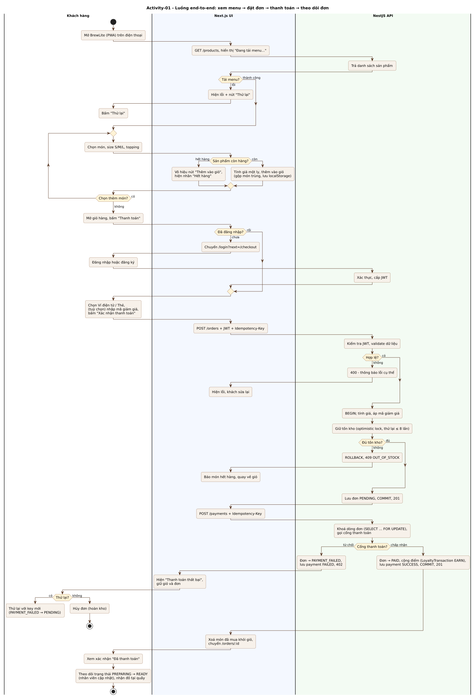
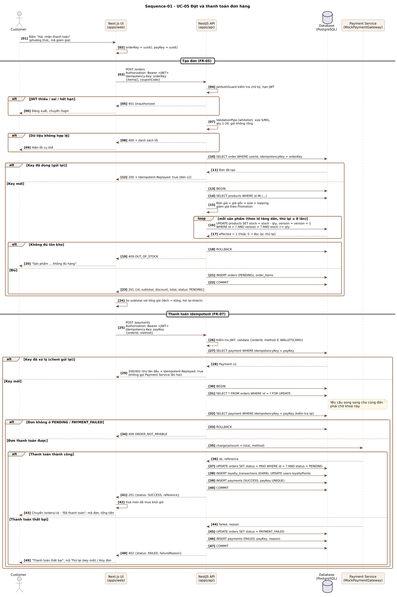
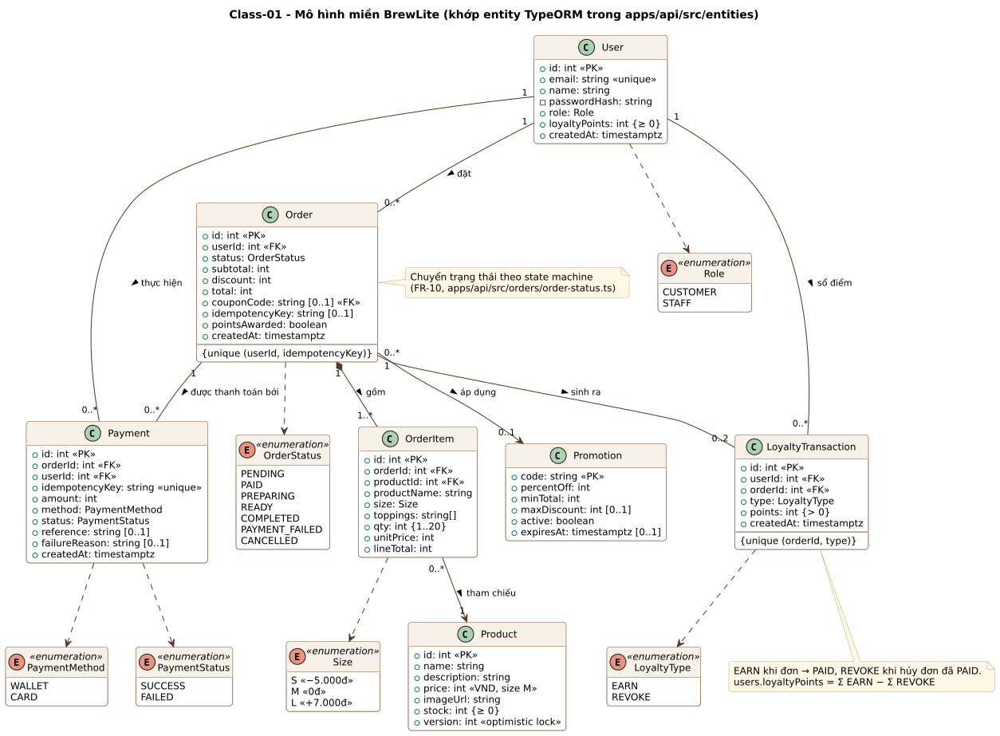

# Sơ đồ BrewLite (Task 2 và Task 3)

Mọi sơ đồ viết bằng **PlantUML** (tệp nguồn `.puml`) và có ảnh kết xuất `.svg` cùng tên, nằm cạnh nhau. Sửa sơ đồ thì sửa tệp `.puml`, chạy lệnh kết xuất, rồi commit cả hai tệp trong cùng một pull request (ghi lý do trong mô tả PR).

```bash
# Cần Java 11+ và Graphviz. Tải plantuml.jar tại https://github.com/plantuml/plantuml/releases
cd docs/diagrams
java -jar plantuml.jar -tsvg *.puml
```

| Mã | Sơ đồ | Nguồn | Ảnh | Task | Dùng cho |
|---|---|---|---|---|---|
| UseCase-00 | Use-case tổng quát | [usecase-overview.puml](usecase-overview.puml) | [svg](usecase-overview.svg) | 1.2 | SRS mục 5 |
| UseCase-01 | Use-case UC-05 Đặt và thanh toán | [usecase-checkout.puml](usecase-checkout.puml) | [svg](usecase-checkout.svg) | 1.3 | Đặc tả UC-05 |
| Activity-01 | Luồng end-to-end menu → thanh toán → theo dõi đơn, có swimlane, hết hàng, chưa đăng nhập, thanh toán lỗi | [activity-checkout.puml](activity-checkout.puml) | [svg](activity-checkout.svg) | 2.1 | FR-01 → FR-10 |
| Sequence-01 | UC-05: Customer → Next.js UI → NestJS API → Database → Payment Service | [sequence-checkout.puml](sequence-checkout.puml) | [svg](sequence-checkout.svg) | 2.2 | FR-05, FR-07 |
| Class-01 | Mô hình miền: User, Product, Order, OrderItem, Payment, Promotion, LoyaltyTransaction + enum | [class-domain.puml](class-domain.puml) | [svg](class-domain.svg) | 2.3 | FR-02 → FR-12 |
| C4-01 | System Context | [c4-context.puml](c4-context.puml) | [svg](c4-context.svg) | 3.1 | Kiến trúc |
| C4-02 | Container | [c4-container.puml](c4-container.puml) | [svg](c4-container.svg) | 3.1 | Kiến trúc |
| Deploy-01 | Deployment production (Render + GHCR + GitHub Actions) | [deployment-production.puml](deployment-production.puml) | [svg](deployment-production.svg) | 3.2 | NFR-07, NFR-08 |

Thư mục [`drawio-assignment1/`](drawio-assignment1/) giữ 21 sơ đồ draw.io của báo cáo Assignment 1 để tham khảo.

## Activity-01



## Sequence-01



## Class-01



## Kiểm tra nhất quán giữa các sơ đồ, SRS và mã nguồn

| Điểm kiểm tra | SRS / Use-case | Sơ đồ | Mã nguồn |
|---|---|---|---|
| Chưa đăng nhập phải đăng nhập trước khi đặt đơn | FR-05 tiêu chí 6, UC-05 A1 | Activity-01 nhánh “Đã đăng nhập? chưa”; UseCase-01 «include» UC-04 | `useRequireAuth`, `JwtAuthGuard` trên `OrdersController` |
| Giá do server tính | FR-05, BR-01 | Sequence-01 bước 14–15 | `orders.service.ts` gọi `unitPrice()` trong `common/catalog.ts` |
| Hết hàng → 409, rollback cả đơn | FR-05, UC-05 E3 | Activity-01 “Đủ tồn kho? không”; Sequence-01 bước 18–20 | `stock.service.ts` (optimistic lock, `version`, thử lại ≤ 8) |
| Idempotency khi gửi lại | FR-07, UC-05 A4 | Sequence-01 bước 10–12 và 27–29 | `payments.service.ts`, `payments.idempotencyKey` UNIQUE |
| Thanh toán thất bại → `PAYMENT_FAILED`, thử lại | FR-07, UC-05 E5, A5 | Activity-01 nhánh “từ chối”; Sequence-01 alt thất bại | `order-status.ts` cho phép `PAYMENT_FAILED → PENDING` |
| 7 trạng thái đơn | FR-10 | Class-01 enum `OrderStatus` | `orders/order-status.ts` |
| Điểm thưởng EARN/REVOKE | FR-12, BR-03 | Class-01 `LoyaltyTransaction`; Sequence-01 bước 38 | `entities/loyalty-transaction.entity.ts`, `promotions.service.ts` |
| Thuộc tính và quan hệ trong Class-01 | – | Class-01 | Khớp entity TypeORM và migration `1794971723916-AddRelationsAndChecks` (khoá ngoại, CHECK) |
