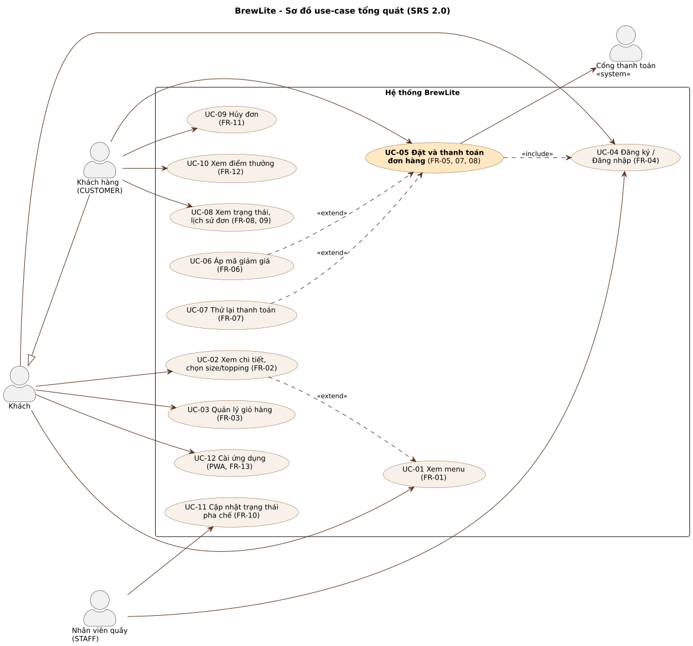

# Task 1.2 – Đặc tả yêu cầu phần mềm (SRS rút gọn)

| Thuộc tính | Giá trị |
|---|---|
| Sản phẩm | BrewLite 2.0 |
| Ưu tiên | MoSCoW: **Must** (bắt buộc cho MVP), **Should** (nên có, làm nếu kịp trong Sprint), **Could** (có thì tốt), **Won't** (không làm ở bản này) |
| Mã kiểm thử | `UT-xx` unit test API · `INT-Txx` integration test API · `FE-Txx` test component web · `E2E-T01` Playwright end-to-end · `UI-<nhóm>` bộ 55 kịch bản giao diện (xem [BrewLite_Bao_cao_kiem_thu.pdf](../BrewLite_Bao_cao_kiem_thu.pdf)) |
| Truy vết | [../traceability-matrix.md](../traceability-matrix.md) |

## 1. Actor

| Actor | Mô tả |
|---|---|
| Khách (chưa đăng nhập) | Xem menu, chi tiết, quản lý giỏ hàng |
| Khách hàng (CUSTOMER) | Như trên, thêm đặt đơn, thanh toán, xem/hủy đơn của mình, xem điểm |
| Nhân viên quầy (STAFF) | Xem mọi đơn, cập nhật trạng thái pha chế |
| Cổng thanh toán (hệ thống) | Xử lý giao dịch Ví/Thẻ (MVP: `MockPaymentGateway`) |

## 2. Yêu cầu chức năng

| Mã | Nhóm | Yêu cầu | MoSCoW | Tiêu chí chấp nhận (kiểm chứng được) | Test |
|---|---|---|---|---|---|
| FR-01 | Menu | Hệ thống hiển thị menu đồ uống gồm ảnh, tên, giá size M (VND) và nhãn “Hết hàng” khi tồn kho bằng 0. | Must | 1) `GET /products` trả 200 với mảng `{id, name, price, imageUrl, stock}`. 2) Màn hình Menu hiện trạng thái đang tải, menu rỗng (“Menu đang trống”) và lỗi có nút “Thử lại”. 3) Ở chiều rộng 360px hiển thị lưới 2 cột, không cuộn ngang. 4) Bấm một món mở `/products/:id`. | INT-T01, FE-T01, UI-A, E2E-T01 |
| FR-02 | Chi tiết sản phẩm | Khách xem mô tả, chọn size S/M/L và một hoặc nhiều topping; giá một ly cập nhật ngay. | Must | 1) `GET /products/:id` trả sản phẩm kèm `options.sizes` (S −5.000đ, M 0, L +7.000đ) và `options.toppings` (Trân châu 5.000, Kem 7.000, Thạch dừa 5.000, Espresso shot 10.000). 2) Id không tồn tại trả 404. 3) Đơn giá = giá gốc + chênh lệch size + tổng topping (mỗi topping tính một lần). 4) Sản phẩm hết hàng: nút “Thêm vào giỏ” bị vô hiệu. | INT-T01, UT-05, UT-06, UT-07, UI-A |
| FR-03 | Giỏ hàng | Khách thêm món vào giỏ, đổi số lượng, xoá dòng, xoá tất cả; giỏ giữ nguyên khi tải lại trang. | Must | 1) Cùng sản phẩm + size + bộ topping (không phụ thuộc thứ tự) gộp thành một dòng. 2) Số lượng mỗi dòng từ 1 đến 20; giảm về 0 thì xoá dòng. 3) Tổng tiền = Σ đơn giá × số lượng, định dạng `35.000đ`. 4) Tải lại trang vẫn còn giỏ. | FE-T02, UI-B |
| FR-04 | Xác thực | Khách đăng ký, đăng nhập bằng email + mật khẩu; phiên dùng JWT. | Must | 1) `POST /auth/register` trả 201 kèm `accessToken`; email trùng 409; email sai định dạng hoặc mật khẩu < 6 ký tự trả 400. 2) `POST /auth/login` sai mật khẩu trả 401. 3) Mật khẩu lưu dạng băm bcrypt. 4) API cần đăng nhập trả 401 khi thiếu hoặc sai token. 5) Token hết hạn: giao diện tự đăng xuất và đưa về `/login`. | INT-T02, INT-T03, INT-T04, UI-C |
| FR-05 | Đặt đơn | Khách đã đăng nhập tạo đơn từ giỏ hàng; server tự tính giá, kiểm tra và giữ tồn kho. | Must | 1) `POST /orders` trả 201, đơn ở trạng thái `PENDING`, `total` do server tính (client không gửi giá). 2) Giỏ rỗng, size sai, số lượng ngoài 1–20, trường lạ, sản phẩm không tồn tại trả 400/404. 3) Thiếu hàng trả 409 `OUT_OF_STOCK` và không trừ kho dòng nào. 4) Gửi lại cùng `Idempotency-Key` (kể cả 5 yêu cầu đồng thời) chỉ tạo một đơn. 5) Đặt đồng thời không làm tồn kho âm. 6) Chưa đăng nhập bấm Thanh toán thì chuyển sang `/login` rồi quay lại `/checkout`. | INT-T05, INT-T06, INT-T14, INT-T15, INT-T18, INT-T19, INT-T20, INT-T25, E2E-T01 |
| FR-06 | Đặt đơn – khuyến mãi | Khách nhập mã giảm giá khi đặt đơn. | Should | 1) BREW10 giảm 10% tối đa 20.000đ; WELCOME20 giảm 20% cho đơn từ 100.000đ, tối đa 50.000đ; giảm làm tròn xuống. 2) Mã không tồn tại, hết hạn, chưa đủ đơn tối thiểu trả 400 với thông báo rõ. 3) Mã không phân biệt hoa thường. | UT-08, UT-09, UT-10, INT-T21, INT-T23, UI-D |
| FR-07 | Thanh toán | Khách thanh toán đơn bằng Ví điện tử hoặc Thẻ (mô phỏng); yêu cầu lặp không bị tính tiền hai lần; thanh toán lỗi được thử lại. | Must | 1) `POST /payments` bắt buộc header `Idempotency-Key`, thiếu trả 400. 2) Thành công: 201, đơn → `PAID`. 3) Thất bại: 402, đơn → `PAYMENT_FAILED`, giữ đơn và tồn kho. 4) Gửi lại cùng key trả lại kết quả cũ với 200 + header `Idempotent-Replayed: true`, chỉ có một bản ghi payment. 5) Key dùng cho đơn khác trả 409. 6) Thanh toán đơn đã `PAID` bằng key khác trả 409. 7) Thử lại từ `PAYMENT_FAILED` bằng key mới → `PAID`. | INT-T08, INT-T09, INT-T10, INT-T16, INT-T17, UI-D |
| FR-08 | Xác nhận và trạng thái đơn | Sau thanh toán thành công, khách thấy màn hình xác nhận với mã đơn, món, tổng tiền và trạng thái hiện tại. | Must | 1) Chuyển tới `/orders/:id`, hiển thị “Đã thanh toán”. 2) `GET /orders/:id` chỉ chủ đơn hoặc nhân viên xem được (người khác 403/404). 3) Trạng thái hiển thị bằng nhãn tiếng Việt và gợi ý bước tiếp theo. | E2E-T01, UI-E |
| FR-09 | Lịch sử đơn | Khách xem danh sách đơn của mình, mới nhất trước. | Must | 1) `GET /orders/me` chỉ trả đơn của chính người gọi. 2) Trang `/orders` hiện trạng thái rỗng khi chưa có đơn. | INT-T07, E2E-T01, UI-E |
| FR-10 | Quản lý trạng thái đơn | Trạng thái đơn tuân theo state machine: `PENDING → PAID → PREPARING → READY → COMPLETED`, ngoại lệ `PAYMENT_FAILED` và `CANCELLED`. Nhân viên cập nhật pha chế. | Must | 1) Chỉ 9 chuyển tiếp hợp lệ trong 49 cặp; còn lại trả 409 `INVALID_TRANSITION`. 2) `PATCH /orders/:id/status` chỉ cho role STAFF (khách 403); nhân viên không được đặt `PAID` bằng tay (400). 3) Hai yêu cầu đồng thời không thể cùng chuyển một đơn. | UT-01, UT-02, UT-03, UT-04, INT-T11, INT-T12 |
| FR-11 | Hủy đơn | Khách hủy đơn chưa pha chế. | Should | 1) Hủy được khi `PENDING`, `PAYMENT_FAILED`, `PAID`; trả tồn kho. 2) Hủy đơn đã hủy hoặc đang pha chế trả 409. | INT-T13, INT-T22, UI-E |
| FR-12 | Điểm thưởng | Khách được cộng điểm khi thanh toán và xem số dư, lịch sử điểm. | Should | 1) 1 điểm cho mỗi 10.000đ tổng đơn, làm tròn xuống, cộng đúng một lần khi đơn → `PAID`. 2) Hủy đơn đã `PAID` thu hồi đúng số điểm đã cộng, không để điểm âm. 3) Mỗi lần cộng/thu hồi ghi một `LoyaltyTransaction` (EARN/REVOKE); `GET /loyalty/me` trả `balance` và lịch sử. | UT-11, INT-T16, INT-T21, INT-T22, INT-T26, INT-T27 |
| FR-13 | PWA | Khách cài BrewLite lên màn hình chính và thấy trang thông báo khi mất mạng. | Could | 1) `/manifest.webmanifest` có `name`, `short_name`, `start_url`, `display: standalone`, icon 192 và 512px. 2) Service worker cache tài nguyên tĩnh, không cache API. 3) Mất mạng khi mở trang mới hiện `offline.html`. | Smoke test (manifest), kiểm tra thủ công Lighthouse |
| FR-14 | Giao diện nhân viên | Màn hình cho barista xem hàng đợi và đổi trạng thái. | Won't (bản 2.0) | Đã có API (FR-10); giao diện để phiên bản sau. | – |
| FR-15 | Thông báo đơn sẵn sàng | Đẩy thông báo khi đơn `READY`. | Won't (bản 2.0) | – | – |

## 3. Yêu cầu phi chức năng

| Mã | Nhóm | Yêu cầu | MoSCoW | Tiêu chí chấp nhận | Kiểm chứng |
|---|---|---|---|---|---|
| NFR-01 | Hiệu năng | API phản hồi nhanh với tải MVP. | Must | p95 thời gian phản hồi < 500 ms cho `GET /products`, `POST /orders`, `POST /payments` khi 20 yêu cầu đồng thời (không tính lần “đánh thức” dịch vụ miễn phí). Đo local: trung bình 1,9 ms / 8,5 ms / 7,5 ms; đăng nhập 68 ms do bcrypt. | Log `ms` của RequestLogger; đo trong báo cáo kiểm thử |
| NFR-02 | Hiệu năng | Giao diện tải nhanh trên di động. | Should | First Load JS mỗi trang ≤ 150 KB (hiện ~100 KB); menu hiển thị trong 3 s trên mạng 4G mô phỏng khi dịch vụ đang chạy. | Kết quả `next build`, Lighthouse |
| NFR-03 | Bảo mật | Xác thực an toàn. | Must | Mật khẩu băm bcrypt (cost 10); JWT ký bằng `JWT_SECRET` ≥ 32 ký tự ở production, hết hạn sau 1 ngày; ứng dụng không khởi động nếu thiếu biến bắt buộc. | INT-T02, UT-12…UT-15 |
| NFR-04 | Bảo mật / toàn vẹn | Giao dịch và tồn kho nhất quán khi lỗi mạng và truy cập đồng thời. | Must | Không trừ tiền hai lần cho cùng yêu cầu; không bán vượt tồn kho; đơn lỗi giữa chừng rollback toàn bộ; CSDL có `UNIQUE(idempotencyKey)`, `CHECK stock >= 0`, khoá ngoại. | INT-T14…INT-T20, INT-T25 |
| NFR-05 | Bảo mật | Kiểm soát đầu vào và quyền truy cập. | Must | ValidationPipe whitelist + `forbidNonWhitelisted`; giá do server tính; role guard cho API nhân viên; khách chỉ xem đơn của mình; CORS chỉ nhận origin cấu hình; production chỉ qua HTTPS; CSDL production không mở ra Internet; secret không có trong repo/log (gitleaks). | INT-T04, INT-T06, INT-T07, INT-T12, CI job `secrets` |
| NFR-06 | Tính khả dụng (usability) | Dễ dùng trên điện thoại. | Must | Mobile-first từ 360px, không cuộn ngang; mọi màn hình có trạng thái đang tải, rỗng, lỗi; thông báo lỗi tiếng Việt nêu cách khắc phục; đặt xong một ly trong ≤ 6 thao tác từ menu khi đã đăng nhập. | FE-T01, UI-H, E2E-T01 (khung Pixel 7) |
| NFR-07 | Tính sẵn sàng (availability) | Hệ thống tự phát hiện và khôi phục lỗi. | Should | `GET /health` trả 200 khi API và CSDL hoạt động, 503 khi CSDL mất kết nối; nền tảng tự khởi động lại container không khoẻ; triển khai lỗi tự rollback về phiên bản trước. | INT-T24, smoke test, job rollback trong CD |
| NFR-08 | Khả năng triển khai | Triển khai lặp lại được, tự động. | Must | `docker compose up --build` chạy đủ web + API + CSDL ở local; migration tạo lại schema từ CSDL rỗng; mỗi lần merge vào `main` pipeline tự build image tag bằng commit SHA, đẩy lên GHCR, triển khai và smoke test; có cách rollback trong ≤ 10 phút. | CI/CD, [deployment.md](../deployment.md) |
| NFR-09 | Quan sát được | Có log và phiên bản để điều tra sự cố. | Should | Log JSON một dòng mỗi request (method, path, status, ms), không ghi Authorization/body; `/health` trả commit SHA đang chạy. | INT-T24, log trên Render |
| NFR-10 | Bảo trì | Chất lượng mã được kiểm soát tự động. | Must | PR chỉ merge khi lint, unit test, build, integration và e2e đều xanh; schema chỉ đổi qua migration có `down()`. | CI, branch protection |
| NFR-11 | Tương thích | Chạy trên trình duyệt phổ biến. | Should | Chrome/Edge/Safari 2 phiên bản gần nhất trên Android/iOS và desktop. | E2E (Chromium), kiểm tra thủ công Safari iOS |

## 4. Quy tắc nghiệp vụ

| Mã | Quy tắc |
|---|---|
| BR-01 | Đơn giá một ly = giá gốc size M + chênh lệch size (S −5.000đ, M 0, L +7.000đ) + tổng giá các topping khác nhau. |
| BR-02 | Giảm giá = ⌊tạm tính × phần trăm / 100⌋, không vượt trần của mã, không vượt tạm tính. |
| BR-03 | Điểm = ⌊tổng thanh toán / 10.000⌋, cộng một lần khi đơn → `PAID`, thu hồi một lần khi hủy đơn đã `PAID`. |
| BR-04 | Tồn kho giữ (trừ) khi tạo đơn, trả lại khi hủy đơn. |
| BR-05 | Chỉ đơn `PENDING` hoặc `PAYMENT_FAILED` được thanh toán. |

## 5. Sơ đồ use-case tổng quát

Nguồn: [`docs/diagrams/usecase-overview.puml`](../diagrams/usecase-overview.puml) · Ảnh: [`usecase-overview.svg`](../diagrams/usecase-overview.svg)

| Use-case | Actor | Yêu cầu |
|---|---|---|
| UC-01 Xem menu | Khách | FR-01 |
| UC-02 Xem chi tiết, chọn size/topping | Khách | FR-02 |
| UC-03 Quản lý giỏ hàng | Khách | FR-03 |
| UC-04 Đăng ký / Đăng nhập | Khách, Nhân viên | FR-04 |
| UC-05 Đặt và thanh toán đơn hàng (trọng tâm) | Khách hàng, Cổng thanh toán | FR-05, FR-06, FR-07, FR-08 |
| UC-06 Áp mã giảm giá «extend» UC-05 | Khách hàng | FR-06 |
| UC-07 Thử lại thanh toán «extend» UC-05 | Khách hàng | FR-07 |
| UC-08 Xem trạng thái và lịch sử đơn | Khách hàng | FR-08, FR-09 |
| UC-09 Hủy đơn | Khách hàng | FR-11 |
| UC-10 Xem điểm thưởng | Khách hàng | FR-12 |
| UC-11 Cập nhật trạng thái pha chế | Nhân viên | FR-10 |
| UC-12 Cài ứng dụng (PWA) | Khách | FR-13 |

Đặc tả chi tiết UC-05: [use-case-checkout.md](use-case-checkout.md).
