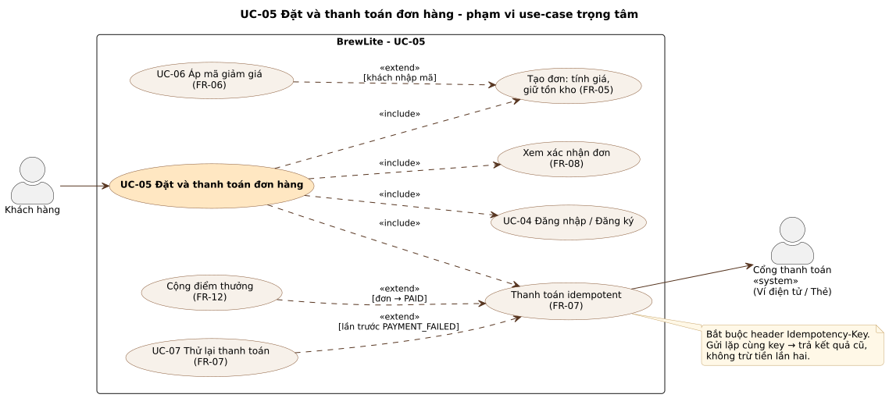

# Task 1.3 – Đặc tả use-case trọng tâm: UC-05 Đặt và thanh toán đơn hàng

Chọn UC-05 vì đây là use-case tạo ra doanh thu và chứa các rủi ro lớn nhất của hệ thống (trừ tiền hai lần, bán vượt tồn kho, thanh toán lỗi).

## 1. Sơ đồ use-case cho phạm vi đã chọn

Nguồn: [`usecase-checkout.puml`](../diagrams/usecase-checkout.puml) · Ảnh: [`usecase-checkout.svg`](../diagrams/usecase-checkout.svg)

## 2. Đặc tả

| Mục | Nội dung |
|---|---|
| Mã, tên | UC-05 Đặt và thanh toán đơn hàng |
| Actor chính | Khách hàng (CUSTOMER) |
| Actor phụ | Cổng thanh toán (mô phỏng Ví điện tử / Thẻ) |
| Mục tiêu | Khách trả tiền cho các món trong giỏ và nhận được đơn ở trạng thái `PAID` để tới quầy nhận đồ uống |
| Trigger | Khách bấm **Thanh toán** ở trang Giỏ hàng (`/cart`) |
| Mức ưu tiên | Must |
| Yêu cầu liên quan | FR-04, FR-05, FR-06, FR-07, FR-08, FR-12; NFR-03, NFR-04, NFR-05, NFR-06; BR-01 → BR-05 |
| Include | UC-04 Đăng nhập (bắt buộc trước khi tạo đơn) |
| Extend | UC-06 Áp mã giảm giá (khi khách nhập mã) · UC-07 Thử lại thanh toán (khi lần trước thất bại) |
| Tiền điều kiện | P1. Giỏ hàng có ít nhất một món. P2. Hệ thống (web, API, CSDL) đang hoạt động. P3. Các món trong giỏ còn trong menu. |
| Hậu điều kiện thành công | S1. Có đúng một đơn `orders` ở trạng thái `PAID`, giá do server tính. S2. Có đúng một bản ghi `payments` trạng thái `SUCCESS` gắn với Idempotency-Key. S3. Tồn kho mỗi sản phẩm giảm đúng số ly đã mua. S4. Khách được cộng ⌊tổng / 10.000⌋ điểm và có một `loyalty_transactions` loại `EARN`. S5. Giỏ hàng được xoá; khách thấy màn hình xác nhận `/orders/:id`. |
| Hậu điều kiện thất bại | F1. Không có tiền bị trừ hai lần. F2. Nếu đơn đã tạo nhưng thanh toán lỗi: đơn ở `PAYMENT_FAILED`, tồn kho vẫn giữ cho đơn, giỏ hàng còn nguyên để thử lại. F3. Nếu tạo đơn lỗi: không có đơn nào được tạo và không trừ kho. |

## 3. Luồng chính

| Bước | Khách hàng | Hệ thống |
|---|---|---|
| 1 | Bấm **Thanh toán** ở giỏ hàng. | |
| 2 | | Kiểm tra phiên đăng nhập (JWT trong trình duyệt). Đã đăng nhập → mở `/checkout`, hiển thị danh sách món, tổng tạm tính, lựa chọn phương thức. |
| 3 | Chọn phương thức **Ví điện tử** hoặc **Thẻ ngân hàng**, (tuỳ chọn) nhập mã giảm giá, bấm **Xác nhận thanh toán**. | |
| 4 | | Web sinh `Idempotency-Key` cho lần đặt đơn, gửi `POST /orders` kèm JWT, danh sách `{productId, size, toppings, qty}` và mã giảm giá. |
| 5 | | API xác thực JWT, validate dữ liệu, mở transaction: đọc giá gốc, tính đơn giá (BR-01), tạm tính, giảm giá (BR-02), giữ tồn kho bằng optimistic locking, lưu đơn `PENDING`, COMMIT. Trả 201 với mã đơn và `total`. |
| 6 | | Web so tạm tính của đơn (`subtotal`) với tổng trong giỏ. Khớp → sinh `Idempotency-Key` thanh toán, gửi `POST /payments` `{orderId, method}`. |
| 7 | | API kiểm tra key chưa dùng, mở transaction, khoá dòng đơn (`SELECT … FOR UPDATE`), gọi cổng thanh toán với số tiền `total`. |
| 8 | | Cổng trả thành công. API chuyển đơn `PENDING → PAID`, cộng điểm (BR-03), lưu `payments` (`SUCCESS`), COMMIT, trả 201. |
| 9 | | Web xoá các món đã mua khỏi giỏ, chuyển tới `/orders/:id`. |
| 10 | Thấy màn hình xác nhận: mã đơn, món, tổng tiền, trạng thái **Đã thanh toán** và hướng dẫn tới quầy nhận đồ uống. | |

## 4. Luồng thay thế

| Mã | Tại bước | Điều kiện | Xử lý |
|---|---|---|---|
| A1 | 2 | Khách chưa đăng nhập | Chuyển tới `/login?next=/checkout`. Khách đăng nhập hoặc chọn **Đăng ký** (UC-04). Thành công → quay lại bước 2, giỏ hàng giữ nguyên. |
| A2 | 3 | Khách nhập mã giảm giá hợp lệ (UC-06) | Bước 5 áp dụng giảm giá; màn hình xác nhận hiển thị tạm tính, giảm giá, tổng. |
| A3 | 6 | Tạm tính server khác tổng trong giỏ (giá vừa thay đổi) | Dừng trước khi thanh toán, báo giá mới, chờ khách xác nhận; xác nhận → tiếp bước 6 với đơn đã tạo; huỷ → khách sửa giỏ. |
| A4 | 4–8 | Khách bấm nút nhiều lần hoặc trình duyệt gửi lại yêu cầu do mạng chập chờn (cùng Idempotency-Key) | `POST /orders`: trả lại đơn đã tạo (200, `Idempotent-Replayed: true`), không tạo đơn mới. `POST /payments`: trả lại kết quả lần đầu, không gọi cổng thanh toán lần hai. |
| A5 | 3 | Khách quay lại thanh toán một đơn `PAYMENT_FAILED` (UC-07) | Web dùng lại đơn cũ (`/checkout?order=<id>`), bỏ qua bước 4–5; bước 7 chuyển đơn `PAYMENT_FAILED → PENDING` rồi thanh toán bằng key mới. |

## 5. Luồng ngoại lệ

| Mã | Tại bước | Điều kiện | Xử lý của hệ thống | Kết quả cho khách |
|---|---|---|---|---|
| E1 | 5 | Dữ liệu không hợp lệ (giỏ rỗng, size sai, số lượng ngoài 1–20, trường lạ) | 400, không tạo đơn | Thông báo lỗi cụ thể, ở lại `/checkout` |
| E2 | 5 | Mã giảm giá sai, hết hạn hoặc chưa đủ đơn tối thiểu | 400, rollback | “Mã giảm giá không hợp lệ / đã hết hạn / Đơn tối thiểu …”, khách sửa hoặc bỏ mã |
| E3 | 5 | Không đủ tồn kho cho ít nhất một món | 409 `OUT_OF_STOCK`, rollback toàn bộ đơn, không trừ kho món nào | “Sản phẩm … chỉ còn N ly”, khách quay lại giỏ để giảm số lượng |
| E4 | 4, 6 | JWT hết hạn hoặc không hợp lệ | 401 | Web tự đăng xuất, chuyển tới `/login`, giỏ hàng giữ nguyên |
| E5 | 8 | Cổng thanh toán từ chối | Đơn → `PAYMENT_FAILED`, lưu `payments` (`FAILED`, lý do), COMMIT, trả 402; không cộng điểm | “Thanh toán thất bại: …”, nút **Thử lại** (A5) hoặc **Hủy đơn** (UC-09) |
| E6 | 7 | Đơn không còn ở `PENDING`/`PAYMENT_FAILED` (đã thanh toán hoặc đã hủy) | 409 `ORDER_NOT_PAYABLE`, không gọi cổng | Thông báo trạng thái hiện tại của đơn, link tới chi tiết đơn |
| E7 | 7 | Idempotency-Key đã dùng cho một đơn khác | 409 | Web sinh key mới và thử lại |
| E8 | 4–8 | Mất kết nối tới máy chủ | Không có phản hồi | “Không kết nối được máy chủ. Vui lòng thử lại.” Bấm lại dùng cùng key nên an toàn (A4) |

## 6. Quy tắc và yêu cầu đặc biệt

- Giá và tổng tiền luôn do server tính (BR-01, BR-02); client không gửi giá.
- Thời gian phản hồi của bước 5 và bước 7–8 dưới 500 ms (NFR-01).
- Giao diện dùng được bằng một tay trên màn hình 360px (NFR-06).

## 7. Từ tiêu chí chấp nhận tới test

| Tiêu chí | Test |
|---|---|
| Luồng chính bước 1–10 trên khung hình điện thoại | E2E-T01 |
| S1, S3 – đơn `PENDING`, giá server, trừ kho | INT-T05 |
| A1 – chưa đăng nhập chuyển `/login` rồi quay lại | E2E-T01, UI-C |
| A2, E2 – mã giảm giá | INT-T21, INT-T23, UT-08…UT-10 |
| A3 – giá đổi khi đang xem giỏ | UI-F (kịch bản F04) |
| A4 – gửi lặp cùng key | INT-T14, INT-T15, INT-T16 |
| A5, E5 – thanh toán lỗi rồi thử lại | INT-T09, UI-D |
| E1 – validate | INT-T06 |
| E3 – hết hàng, đồng thời | INT-T18, INT-T19, INT-T20 |
| E4 – token sai/hết hạn | INT-T04, UI-C |
| E6, E7 – đơn không thanh toán được, key cho đơn khác | INT-T10, INT-T17 |
| S4 – điểm thưởng và LoyaltyTransaction | INT-T21, INT-T26 |
